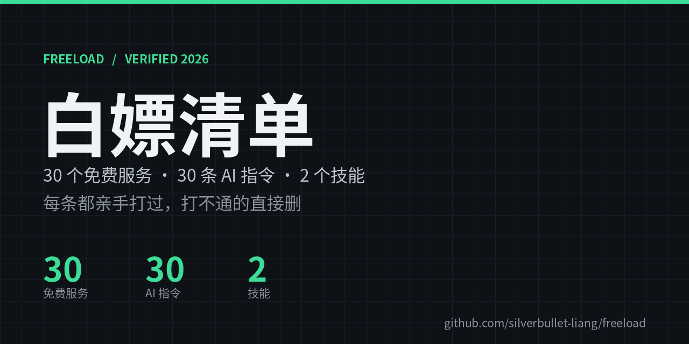

# Freeload

**Free tier, but actually verified.** 29 free services, 30 prompts, 2 installable skills — every entry tested by hand, dead links deleted instead of kept as filler.

> 中文主表在 [README.md](README.md)：每条都带额度、门槛、坑与核对日期。

## What's in here

| Section | Rows | What it is |
| :-- | :--: | :-- |
| AI | 5 | Free model APIs — text, image, video. Free tokens, free keys. |
| Cloud storage | 2 | Free storage, plus "file pools" you can search and share. |
| Hosting | 10 | Static hosts, PHP hosts, and publishing a page straight from your phone. |
| APIs | 12 | Free weather, music, TTS and video-parse endpoints. |
| Prompts | 30 | The prompts I actually use — one file each, sorted by purpose. |
| Skills | 2 | Installable skill packages: a video factory and a browser driver. |

## Quick picks

| You want | Take | Why |
| :-- | :-- | :-- |
| Text + image + video, all free | Agnes AI | All three modes, no token cap, only RPM limits |
| No signup at all | Pollinations | No key, no account — one image per 45s |
| A static site that lasts | Cloudflare Pages | 500 builds/mo, unlimited bandwidth, 20k files |
| Publish a page from your phone | Kimi CDN | Publish from the app, get a public URL |
| Anonymous one-off page | ship.page | One curl, lives 30 days |
| Free PHP host | InfinityFree | 5GB, 400 databases, 3 sites per account |
| 5TB for documents | Doubao AI Cloud | Free 5TB, documents and images only |
| An uncapped file pool | AI chat as storage | One chat = one folder, searchable, shareable |
| Free weather / music API | Open-Meteo / Injahow | Both keyless, both answered 200 |
| Turn a doc into a video | pocket-explainer | One command, narrated mp4 with subtitles |
| Drive a browser with an agent | chrome-kernel-installer | Numbered screenshot, click by number |

## How verification works

- **Every row carries a `checked` date** and a pitfalls column: rate-limit math, quota cuts, silent billing, docs that are stale.
- **A weekly GitHub Action re-tests every endpoint** and opens an issue when something dies. The badge above turns red when it finds one.
- **Dead entries get deleted, not tombstoned.** If it does not answer, it does not belong here.
- **"Free" means free**: no pay-first-then-refund, no invite-to-unlock, no card required to try.

## Gates

| Gate | Meaning |
| :-- | :-- |
| free | no signup |
| email | signup, no payment details |
| phone | SMS code only, no ID verification |
| github | GitHub OAuth |
| KYC | ID card / face verification |
| card | card on file — mind auto-renew |

## Ratings

Tier list, best first:

| Tier | Meaning |
| :--: | :-- |
| Top | Ceiling of what you can get for free |
| Great | Very usable, one small friction |
| Decent | Real upside, but quota or rate limit bites |
| Meh | Works, do not build on it |
| Avoid | Free in name only |

Rating is not the same as raw capability — a tier also weighs ecosystem and account experience. That is why the server section ships a separate 5-point table (speed / speed-to-publish / limits / branding).

## Prompts

30 prompts in six categories, one file each — index at [`prompts/`](prompts/README.md). Copy, paste, nothing to configure.

## Skills

| Skill | What it does |
| :-- | :-- |
| [pocket-explainer](skills/pocket-explainer/SKILL.md) | Turns a topic or a document into a finished mp4: voice-over, subtitles, chapter bar, 6 visual themes, one command. |
| [chrome-kernel-installer](skills/chrome-kernel-installer/SKILL.md) | Installs a headless Chrome kernel and drives it over CDP: numbered screenshots, then click / type / scroll by number. |

Both are self-contained directories (`SKILL.md` + scripts + templates). Drop them into any client that supports skills.

## Contributing

Tables live in `data/*.json`; run `python3 tools/build.py` and the README re-renders. An entry needs five fields: `name` `url` `what` `gate` `rating`. Three rules: genuinely free, usable long-term, alive right now.

## License

MIT
